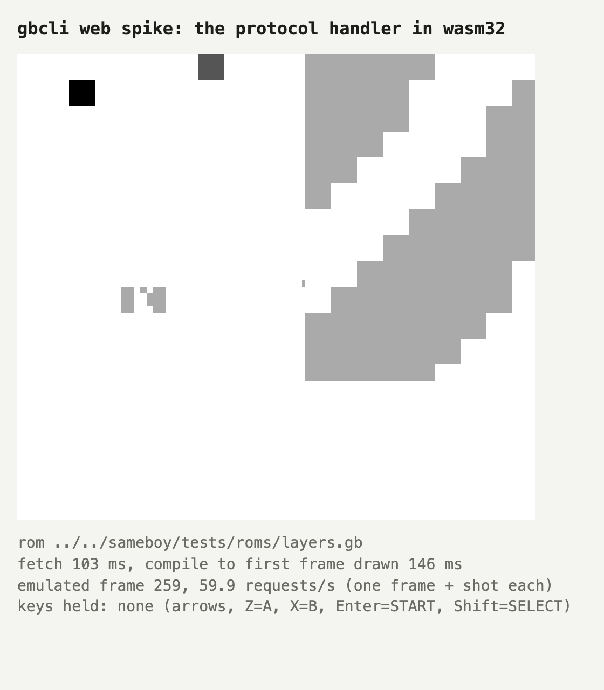

# Findings: the web spike, gbcli's handler built for wasm32 and run in a browser

2026-11-09, nineteenth session. Session 1 (leaf 3zNDPj) built the handler for `wasm32-wasip1` and checked it against native from Node; session 2 (leaf 0Mfl87) ran it in a browser, measured it, and wrote the answers below. The plan and Ben's rulings are in [2026-11-09-web-spike-plan.md](2026-11-09-web-spike-plan.md), and the web ruling is in [2026-11-09-web-target.md](2026-11-09-web-target.md). The RGBDS research (leaf LMjWWK) is folded in below, from [2026-11-09-web-spike-rgbds.md](2026-11-09-web-spike-rgbds.md) on main. This doc rides on the `spike/web` branch.



## Headline answers

1. **gbcli runs in a browser, unchanged but for the cuts listed below, and it's byte-identical to native.** The page loads the `wasm32-wasip1` module through `@bjorn3/browser_wasi_shim` 0.4.2 with an in-memory filesystem. It sends the protocol's own `run` requests and draws the shot PNG each frame to a canvas at 60 requests/s. In headless Chromium 156, session 1's check request on `layers.gb` (600 frames, keys, reads, shot, WAV) gives the same response line, PNG SHA-256 and WAV SHA-256 as the native build. Session 1 showed the same under Node for 7 runs.
2. **Speed is acceptable: about 800 fps in the browser, two-thirds of native, about 13 times real time.** On `layers.gb` (3,000-frame runs, median of 3 interleaved rounds), Chromium gave 797 fps, Node 786 to 797, and native 1,175 (1,235 at the lowest load). The Game Boy runs at 59.7 fps. Start-up, from compiling the module to the first frame's PNG in hand, is 144 ms in Chromium; native takes 78 ms to its first frame. A one-frame request with a shot costs 2.15 ms in the browser and 2.21 ms natively.
3. **So the bespoke-core backlog entry's web condition doesn't hold.** SameBoy builds for `wasm32`, runs exactly, and runs fast enough. The entry stays parked on the web's account.
4. **Toolchain: wasi-sdk with `wasm32-wasip1`.** It runs as-is in Node and, through a 43 KB JS shim, in a browser. Two traps cost this spike time; both have fixes below. Without a reactor link, every export re-ran SameBoy's C constructors, which made a request about 3 times slower. And the shim keeps no file times, which the bundle store needs.
5. **The whole CLI also runs in the module, so the help is reachable today.** `gbcli-cli` builds for `wasm32-wasip1` as it is. Its `run(args, &Env, Io)` is already a library entry point that doesn't need a process. Linked in, it answers the primer, `help traps`, `run --help`, `recipes`, and real verbs printed as rows. That adds 543 KB to the gzipped module.
6. **Size:** the module with the CLI is 8.98 MB raw, 7.15 MB stripped, 1.99 MB under gzip -9 and 1.23 MB under brotli. The handler alone is 6.13 / 4.95 / 1.44 / 0.96 MB. RGBDS's three tools add 0.35 MB gzipped (from the RGBDS research).
7. **What a real web build needs is a short list, and none of it is SameBoy:** a store trait, or a host-persisted WASI filesystem; a host and an interrupt passed into the `Handler` in place of `Host::from_process` and the watchdog thread; no panics on reachable paths, because a panic aborts the module and loses everything held in memory; the RGBDS tool-runner seam; and an answer for rgbgfx.

The recommendation for Ben is at the end, in [Recommendation](#recommendation).

---

*Session 1's findings follow, as session 1 wrote them, with in-place corrections where session 2 changed the build. Session 2's start at [The page](#the-page-session-2).*

## Session 1's headline answers

1. **SameBoy, the engine and the whole protocol handler build for `wasm32-wasip1`.** This is `gbcli-server` itself, with `gbcli-build`, `gbcli-bundle`, `gbcli-view` and `gbcli-audio`, built with wasi-sdk 34. It needed no change to SameBoy's C or to the shim, and the C produced no warnings. Nothing failed to compile: Rust's wasip1 `std` compiles `std::process`, `std::thread` and file locks, and they fail at run time instead. That's why the cuts below were found by running, not by compiling.
2. **Runs are bit-identical to native.** Node drives the `.wasm` handler with a `run` request: N frames, a key timeline, reads, a shot and a WAV. On 7 runs (5 ROMs on DMG, 2 on GBC), the wasm and native builds gave the same response line, the same PNG SHA-256 and the same WAV SHA-256. For `layers.gb`, the real native `gbcli run` gives the same PNG hash. In a separate check, all 32,768 RGB555 colors convert identically on a GBC. That conversion runs libm's `pow`, the one place wasi-libc's libm could round differently from Apple's.
3. **The handler needed four run-time cuts, each a `cfg(target_family = "wasm")`:** `std::process::id()` (it panics) in `gbcli-bundle` and `gbcli-build`, `File::try_lock` (unsupported) in the session lock, and the watchdog thread (spawning one is unsupported). One known abort remains: `std::env::temp_dir()` panics on WASI, and `assets` uses it. Every other op probed answers (table below).
4. **Size:** 6,125,792 bytes raw (release), 4,948,142 stripped, 1,442,252 stripped and gzip -9. That is the whole handler, including the build, font, music, pixel and view crates.
5. **The bespoke-core backlog entry's web condition doesn't hold on build or correctness:** SameBoy builds and runs exactly under wasm32. "Acceptably" also means speed, which spike 2 measures.

> **Correction, session 2 (leaf 0Mfl87):** item 4's sizes are for session 1's build. Session 2 linked the module as a reactor (`crates/web/build.rs`, which fixed constructors re-running on every export) and added the CLI behind a default `cli` feature. The handler alone is now 6,125,317 bytes raw, 4,947,643 stripped and 1,442,537 stripped and gzipped; with the CLI, 8,977,439 / 7,152,336 / 1,985,242 ([Size](#size)). Item 5's open question, speed, is answered: about 800 fps in a browser, 0.68 of native ([Figures](#figures-session-2)).

## Toolchain, and why

**wasi-sdk 34 (clang 23.1.0-wasi-sdk) with Rust's `wasm32-wasip1` target, run under Node 26.13.0's built-in `node:wasi`.**

- **Why wasi-sdk first:** SameBoy's C includes `stdio.h`, `time.h`, `unistd.h` and `sys/select.h`, and calls `malloc`, `fopen`, `printf`, `vasprintf`, `time` and libm. wasi-libc has all of it, and Rust's wasip1 target links wasi-libc already, so the cc crate's C and Rust's `std` share one libc and one allocator. Emscripten also has the libc, but Rust's `wasm32-unknown-emscripten` target is lower-tier and brings Emscripten's JS runtime. `wasm32-unknown-unknown` has no libc at all (tried below).
- **The price:** the module imports 23 `wasi_snapshot_preview1` functions (files, clocks, `random_get`, `poll_oneoff`, `proc_exit`). Node provides them. A browser needs a WASI shim with an in-memory filesystem (for example `@bjorn3/browser_wasi_shim`); that's spike 2. wasm-bindgen targets `wasm32-unknown-unknown`, not wasip1, so the spike's JS boundary is hand-written C-ABI exports with JSON in and out, not wasm-bindgen. wasm-bindgen-cli wasn't installed.
- **`wasm32-unknown-unknown`, tried:** `cargo build -p sameboy-sys --target wasm32-unknown-unknown` with wasi-sdk's clang fails at once: `SameBoy/Core/display.c:2:10: fatal error: 'stdlib.h' file not found`. Getting there means writing a small libc for exactly the symbols SameBoy imports, listed below. That's feasible (they're few, and the file and clock ones are on paths gbcli never calls), but it's work wasi-sdk makes unnecessary.

### Installs (Ben's ruling allowed these)

```
rustup target add wasm32-wasip1 wasm32-unknown-unknown
curl -sSL -o ~/.local/wasi/wasi-sdk-34.0-arm64-macos.tar.gz \
  https://github.com/WebAssembly/wasi-sdk/releases/download/wasi-sdk-34/wasi-sdk-34.0-arm64-macos.tar.gz
tar -xzf ~/.local/wasi/wasi-sdk-34.0-arm64-macos.tar.gz -C ~/.local/wasi
```

### Build and check

`scripts/web/build-spike.sh` does all of this. By hand, from the repo root:

```
CC_wasm32_wasip1=$HOME/.local/wasi/wasi-sdk-34.0-arm64-macos/bin/clang \
AR_wasm32_wasip1=$HOME/.local/wasi/wasi-sdk-34.0-arm64-macos/bin/llvm-ar \
  cargo build -p gbcli-web --target wasm32-wasip1 --release
cargo build -p gbcli-web --release --examples          # the native references
node crates/web/node/check.mjs target/wasm32-wasip1/release/gbcli_web.wasm \
  crates/sameboy/tests/roms/layers.gb target/release/examples/native_ref 600 [MODEL]
node crates/web/node/colors.mjs target/wasm32-wasip1/release/gbcli_web.wasm \
  crates/engine/tests/roms/gbc_palette.gb target/release/examples/native_colors
node crates/web/node/probe.mjs target/wasm32-wasip1/release/gbcli_web.wasm crates/sameboy/tests/roms/layers.gb
```

The cc crate needed nothing beyond `CC_`/`AR_` for the target: `sameboy-sys/build.rs` is unchanged, and so are the vendored patches and the shim.

## What the spike crate is

`crates/web` (`gbcli-web`) is a `cdylib` + `rlib`. It does what the CLI's `start_handler` does: `Bundle::open_or_create`, `open_session` (creating the session from the ROM), `Handler::new`, `set_host`. It answers request lines through `gbcli_server::serve`, exactly as `gbcli serve` does. So this is the protocol handler, not the engine with the handler bypassed; nothing in the adapters was too tangled to keep. Its exports:

- `gbw_alloc` and `gbw_free` manage buffers.
- `gbw_put_file(path, bytes)`: the ROM goes in as bytes, written into the WASI filesystem.
- `gbw_open({"dir","session","rom","model"?})` opens the handler.
- `gbw_request(line) -> line` answers one protocol request.
- `gbw_get_file(path) -> bytes`: the shot's PNG and the WAV come out as bytes.
- `gbw_color_table_sha256(rom)` hashes the color table, through the engine directly.

Results come back as one packed `u64` (`ptr << 32 | len`). JavaScript sees it as a *signed* BigInt, so `check.mjs` applies `BigInt.asUintN(64, …)`.

The session bundle stays the filesystem, as WASI exposes it: Node preopens a temp directory as `/work`, and a browser shim would hold the same tree in memory. The handler, the bundle store and every op run unchanged on it, which is what makes this spike cheap. A real web build should still replace that with a store trait (below), not lean on a WASI filesystem forever.

The frame: `run` with `shot` writes a PNG into the WASI filesystem, and JS reads it back with `gbw_get_file`. The state is the protocol's own `Response` (stop record, reads, shot and audio results) as its JSON line.

## The determinism check

`crates/web/node/check.mjs` runs one `run` request through the wasm handler under Node's WASI, and the same request through the same `Spike` calls built natively (`crates/web/examples/native_ref.rs`). The request: N frames, keys `START@10 -START@12 A@60 -A@70 RIGHT@100 -RIGHT@160`, reads `a pc [$FF40]`, a 1x shot and a mixed WAV. The check requires the response lines to be byte-identical and the PNG and WAV SHA-256 to match.

| ROM | frames | model | PNG SHA-256 (prefix) | result |
|---|---|---|---|---|
| `crates/sameboy/tests/roms/layers.gb` | 600 | DMG-B (default) | `7dda3185` | identical |
| `crates/sameboy/tests/roms/mode_sweep_win.gb` | 3000 | DMG-B | `14719d14` | identical |
| `crates/sameboy/tests/roms/banked.gb` | 1200 | DMG-B | `e766136b` | identical |
| `crates/audio/tests/roms/tune.gb` | 600 | DMG-B | `3c0bf5b4` (WAV `87388fe6`) | identical |
| `crates/engine/tests/roms/joypad.gb` | 600 | DMG-B | `3c0bf5b4` | identical |
| `crates/engine/tests/roms/gbc_palette.gb` | 600 | gbc (CGB-E) | `9070379f` | identical |
| `crates/sameboy/tests/roms/layers_cgb.gb` | 1200 | gbc | `7f4d0333` | identical |

Reproduce with `scripts/web/build-spike.sh`. `tune.gb` and `joypad.gb` show the same blank screen, so their PNG proves little; their WAVs differ from each other and match across builds. The native CLI agrees: `gbcli run rom.gb --session web --frames 600 --keys 'START@10 -START@12 A@60 -A@70 RIGHT@100 -RIGHT@160' --shot shot.png --scale 1` on `layers.gb`, in a project outside the repo, writes a PNG whose `shasum -a 256` is `7dda318511b88c2ee5da8f85b019bf2d1144b3797ff1b1888a7e45ef2e90439f`, the same as the wasm build's.

The color table (`node/colors.mjs`) hashes SameBoy's `GB_convert_rgb15` for all 32,768 colors on a CGB-E under default color correction, which calls `pow`. Wasm and native both give `98f5aa28…` (the full hash is in the check's output). The APU's band-limited synthesis table uses `sin` and `cos`, and the WAVs match.

## What SameBoy's C needed from libc, and how it was handled

`llvm-nm -u` on the wasip1 `libsameboy.a` lists every libc symbol SameBoy and the shim import:

| Need | Symbols | Where | Handled |
|---|---|---|---|
| Heap | `malloc` `calloc` `realloc` `free` | everywhere | wasi-libc; one allocator shared with Rust |
| File I/O | `fopen` `fread` `fwrite` `fseek` `ftell` `fclose` | `GB_load_rom`/boot ROM/battery/state *by path*, cheats, audio recording (`apu.c`) | Linked but never called: gbcli loads everything from buffers (`GB_load_boot_rom_from_buffer`, ROM and states from memory) |
| Logs | `printf` `vasprintf` | `gb.c` default log | gbcli sets a log callback (`hooks::on_log`) |
| Text | `sscanf` `strlen` `strncpy` `strerror` `errno` | cheats, error paths | wasi-libc |
| Clocks | `time` `gettimeofday` `nanosleep` `localtime` `mktime` | RTC stamps, `GB_timing_sync`, random seed, WorkBoy | Never on gbcli's path: turbo is uncapped (`GB_set_turbo_mode(true, true)`, cap 0), so timing sync never sleeps; the shim pins `last_rtc_second`; RTC runs in accurate (emulated) mode; the RNG is seeded. They still link, and Node's `clock_time_get` and `poll_oneoff` back them |
| RNG | `rand` | `apu.c` `interference()`, only while an interference volume is set | Never called: gbcli never calls `GB_set_interference_volume`, so it stays 0. Were it on, wasm and native would differ, since each libc's unseeded `rand()` gives its own sequence |
| libm | `pow` `round` `sin` `cos` `exp2` | color correction, APU, SGB, joypad | wasi-libc's libm (musl's); identical to native on everything checked |

- **Boot ROMs** are embedded with `include_bytes!` (`crates/sameboy-sys/src/lib.rs`, `bootroms/*.bin`) and loaded from a buffer, so no file is read.
- **`setjmp`/`longjmp`:** none. **Threads:** none in the C.
- `memcpy` and `memset` don't appear as imports: clang 23 lowers them to wasm bulk-memory instructions.
- The `random_get` import comes from Rust's `std` (HashMap's `RandomState` seeds), not from SameBoy.
- A minimal libc for `wasm32-unknown-unknown` would need exactly the table above. Of it, only the heap, the text functions and libm are on gbcli's path; the file and clock functions could be stubs that fail.

## Every adapter cut, and what a real web build needs instead

Each cut is marked `WEB SPIKE CUT` in the source and gated on `cfg(target_family = "wasm")`, so native builds are unchanged (`cargo test --workspace` passes).

| Cut | Where | What failed on wasm32 | Spike's cut | What a real web build needs |
|---|---|---|---|---|
| Process id | `gbcli-bundle` `io::process_tag` (temp names in `atomic_write`, `new_incarnation`), used by `gbcli-server` `handle/shot.rs`; `gbcli-build` `process_tag` (`doctor.rs` probe file, `project/staging.rs`, `assets.rs` scratch) | `std::process::id()` panics: "no pids on this platform", aborting the module | returns 0 on wasm | Nothing in a store that isn't files: temp-and-rename and per-process names are filesystem idioms. An in-memory or browser-storage store replaces them; an incarnation needs only a counter or a random value |
| Session lock | `gbcli-bundle` `lock.rs` `acquire` | `File::try_lock`: "try_lock() not supported" (`io_failed` on `open`) | skips the flock and returns the lock over the opened file | A store trait whose lock is the store's own: none for a single in-memory store; a Web Lock (`navigator.locks`) if two tabs share browser storage. The lock file's mtime, which pruning reads as last use, becomes a field |
| Watchdog thread | `gbcli-server` `watchdog.rs` `Watchdog::new` | `thread::Builder::spawn`: "Not supported", which `expect` turned into a panic | no thread; the guard never fires, though a zero allowance still interrupts | An interrupt the host controls, not a thread: emulation already polls an `AtomicBool`. A web host can set it from a JS callback between frame batches, or the handler can take a frame or tick budget per call so the page's event loop stays free (`run` already has budgets). The wall-clock allowance becomes the host's concern |
| Host | `Handler::new` calls `Host::from_process()` | Nothing failed: wasi-libc emulates a cwd of `/`, and `PATH` is unset | `set_host(Host { cwd: dir, path: None })` right after | A `Handler` built with an explicit host and store (web-target doc ▸ When the work starts); `from_process` belongs in the CLI |
| RGBDS | `gbcli-build` `toolchain.rs`, `project/tool.rs` (`Command`, a reader thread, `kill`) | `doctor` and `build` answer `toolchain_missing: rgbasm is not on PATH` because `PATH` is unset; with a `PATH`, `Command::spawn` would fail as unsupported. The message is wrong for wasm: the cause is "no subprocesses here" | none (out of scope; the RGBDS leaf) | The one seam the web ruling names: the tools behind a trait that takes the project's sources as data and returns ROM, `.sym`, `.map` and diagnostics. `doctor`'s git and `PATH` checks need a web answer too |
| Temp directory | `gbcli-build` `assets.rs` `Scratch::new` (`std::env::temp_dir()`), and the transient PNG it writes for rgbgfx | Panics on WASI: "not supported by WASI yet" (`std/src/sys/paths/wasi.rs:44`), aborting the module. `assets` is the one probed op that does this | none: it's on the rgbgfx path, a subprocess anyway | Scratch space from the store or the host, never `temp_dir()`; and the image conversion's rgbgfx call behind the same build seam |
| Panic guard | `gbcli-server` `serve.rs` (`catch_unwind` around each request) | wasm32 panics abort (`panic = "abort"`), so one panicking request kills the module and every session's warm machine with it; the guard is dead code there | none | Either no panics on reachable paths (the cuts above were all panics), or a host that re-instantiates the module and reloads the store after an abort. Unwinding on wasm needs the exception-handling proposal and a rebuilt `std` |

### The ops probed through one wasm handler

`crates/web/node/probe.mjs` sends these to one handler over `layers.gb`, in order:

- **Answered normally:** version, run, show, checkpoint, run, restore, undo, checkpoints, events, step, read, write, shot, view (tiles), view (memory: refused with `uninitialized_read`, a correct answer), measure, sessions, gaps, opcode, new (it scaffolds the starter into the WASI filesystem), power_cycle, sav (refused, correctly: `layers.gb` has no battery), prune.
- **Refused with `toolchain_missing`:** doctor, build.
- **Aborted the module:** assets.

## Not covered in this session

- No browser: the page, the WASI shim choice and its filesystem, and all timing and start-up figures are spike 2's.
- Not probed: `equiv`, flash carts, battery carts (`sav` on a battery ROM), the font, pixels, song and image ops other than `assets`. The font, pixels and song conversions are data in and data out and should run; their file I/O goes through the same WASI filesystem.
- The spike crate links the whole server, build crate included. A web build that drops `gbcli-build`'s subprocess half would be smaller. Size by crate wasn't measured; `twiggy` or `wasm-opt` weren't installed.

## The page (session 2)

`crates/web/page/` holds a demo page, not a design. The JavaScript is plain ES modules with no build step:

- **`index.html` and `main.js`** fetch the `.wasm` and a ROM, then compile and instantiate the module with the shim, `/work` preopened as an empty in-memory directory. They put the ROM in `/work` with `gbw_put_file`, open the session with `gbw_open`, and on each animation frame send `{"op":"run","args":{"frames":1,"keys":[…],"shot":{"path":"f.png","scale":1}}}`. They read the PNG back with `gbw_get_file` and draw it with `createImageBitmap`. Keys: the arrows, Z for A, X for B, Enter for START and Shift for SELECT. A key goes out once, as `A@0` or `-A@0` in the next run, because held keys persist in the machine between runs. Keys are wired up, but `layers.gb` doesn't visibly react to them, so they're unverified on screen. `?rom=PATH` picks another ROM; `?bench` and `?check` run the benchmark and the determinism check in the page.
- **`gbw.js`** wraps the C-ABI exports for any WASI implementation. It also fixes the shim's file times (below).
- **`bench-core.js`** is the one benchmark the page and Node both run, so their figures come from the same code. `bench.mjs` runs it in Node under the shim or `node:wasi`. `crates/web/examples/native_bench.rs` times the same `Spike` calls natively.
- **`browser.mjs`** drives the page in Playwright's headless Chromium, serving the repo root through request interception on `https://gbw.local`, so no port is opened. Its `demo` mode takes the screenshot above, `bench` runs the benchmark, and `check` compares the page's answer with `native_ref`. `serve.mjs` serves the repo root on `localhost:8137` for a person with a browser.
- **`cli.mjs`** runs the CLI in-process in the module (see [Help](#help-session-2)).

### Installs (session 2)

The npm dependencies are pinned exactly in `crates/web/page/package.json` and `package-lock.json`, and installed into `crates/web/page/node_modules/`, which is gitignored on this branch:

- `@bjorn3/browser_wasi_shim` 0.4.2 (MIT OR Apache-2.0). The page's only runtime dependency: 42,896 bytes of JS, 8,491 gzipped.
- `playwright` 1.64.1 (a dev dependency, released 2026-10-14). Its headless Chromium shell (build 1248, Chromium 156.0.8078.4) is installed under `target/web-spike/ms-playwright`, not in the global cache. Playwright also fetched its ffmpeg there, unasked; the two total 219 MB.

```
npm install --prefix crates/web/page
PLAYWRIGHT_BROWSERS_PATH=$PWD/target/web-spike/ms-playwright \
  npx --prefix crates/web/page playwright install --only-shell chromium
```

With both in place, `scripts/web/build-spike.sh` also runs the browser check after the Node checks. Without them, it skips that check and says so.

### Running it

```
scripts/web/build-spike.sh                       # build both sides, Node and browser checks
node crates/web/page/serve.mjs                   # then open http://localhost:8137/crates/web/page/
PLAYWRIGHT_BROWSERS_PATH=$PWD/target/web-spike/ms-playwright \
  node crates/web/page/browser.mjs demo project/2026-11-09-web-spike-page.png
PLAYWRIGHT_BROWSERS_PATH=$PWD/target/web-spike/ms-playwright \
  node crates/web/page/browser.mjs check crates/sameboy/tests/roms/layers.gb target/release/examples/native_ref 600
```

The browser check prints `response lines identical`, `shot.png … 7dda3185… equal`, `mix.wav … af9aa0ce… equal`, and `PASS`.

## Figures (session 2)

Measured on Ben's Apple M1, with Node 26.13.0, Chromium 156.0.8078.4 (headless shell) and rustc 1.99.1, on a release build. Other agents shared the machine: load average ranged from 6 to 21 during the runs, and every run's load is printed beside it. The wasm figures held steady across that range (786 to 818 fps); native swung from 769 to 1,235 fps, so native's median understates it at low load.

### Frames per second, start-up and per-request cost

```
scripts/web/build-spike.sh
node scripts/web/bench-spike.mjs crates/sameboy/tests/roms/layers.gb 3
```

This runs the four hosts in 3 interleaved rounds, so load hits them alike. Each round warms up with a 600-frame run, then times five 3,000-frame runs (no shot or audio) and reports their median. The table gives the median of the three rounds.

| Host | fps | vs native | start-up to first frame | of which: compile, instantiate, open, first frame | one-frame request with shot |
|---|---|---|---|---|---|
| native (release) | 1,175 (best round 1,235) | 1.00 | 78 ms | –, –, 4.5, 73 | 2.21 ms |
| Node, `node:wasi` | 786 | 0.67 | 155 ms | 9.8, 19.8, 6.9, 119 | 2.85 ms |
| Node, browser_wasi_shim | 797 | 0.68 | 158 ms | 10, 17.7, 7.1, 124 | 2.16 ms |
| Chromium 156, browser_wasi_shim | 797 | 0.68 | 144 ms | 8.1, 17.4, 7.4, 113 | 2.15 ms |

- **What "start-up" counts:** compiling the module's bytes, instantiating it, writing the ROM and opening the session, then a one-frame `run` from power-on with its shot read back as PNG bytes. That's the wait before a page can draw. The first frame dominates it: it runs the boot ROM and writes the boot cache. Compiling is cheap because V8 compiles wasm lazily with its baseline compiler first, and the warm-up run is where the optimizing tier catches up. The page's own status line reads "compile to first frame drawn 146 ms", plus 80 to 103 ms of fetching from the intercepted local route.
- **Real time:** a DMG shows 59.7 frames per second, so the browser runs `layers.gb` at about 13 times real time. The page needs one frame per animation frame and spends 2.15 ms of its 16.7 ms budget on it, PNG encode and decode included.
- **Per-request cost matches native**, even though raw emulation runs at two-thirds of native speed. The in-memory filesystem is cheaper than APFS. The handler's per-request work is 7 `path_open` calls (8 with a shot) (lock, `session.json`, events, the history entry and two temp-and-renames) and one 168,736-byte history checkpoint, and the history ring keeps about 9 of those. So a page's memory doesn't grow with the frame count.
- **One ROM, one browser engine:** this is `layers.gb` (it draws every frame) on Chromium only. Safari's and Firefox's wasm engines weren't measured, and neither were phones.

### Size

```
scripts/web/size-spike.sh
```

| Module | raw | stripped (`llvm-strip`) | stripped, gzip -9 | stripped, brotli -q 11 |
|---|---|---|---|---|
| handler and CLI (`gbcli-web`, the default) | 8,977,439 | 7,152,336 | 1,985,242 | 1,229,926 |
| handler alone (`--no-default-features`) | 6,125,317 | 4,947,643 | 1,442,537 | 962,811 |
| rgbasm + rgblink + rgbfix (Emscripten, from the RGBDS research) | 888,413 | – | 348,411 | 282,402 |
| browser_wasi_shim 0.4.2 (JS) | 42,896 | – | 8,491 | – |

`wasm-opt` and `twiggy` weren't installed, so there's no size by crate and no post-link optimization. The build crate's subprocess half, the font, the music and the CLI's help text are all in the module, and a web build that drops what it can't use would be smaller.

## Two traps, and their fixes (session 2)

### Every export re-ran SameBoy's constructors: link the module as a reactor

The first benchmark under the shim gave 120 ms per one-frame request. A count of WASI calls (`node scripts/web/wasi-calls.mjs target/wasm32-wasip1/release/gbcli_web.wasm crates/sameboy/tests/roms/layers.gb shot`) showed the time wasn't in the host: about 40 calls per request, costing under 0.2 ms in all. A CPU profile of the same script (`node --cpu-prof scripts/web/wasi-calls.mjs …`) put **51.6% of the time in SameBoy's `band_limited_init`**. That's an `__attribute__((constructor))` in `apu.c`, which builds the APU's band-limited step table with 8,192 `sin` and `cos` calls.

A `cdylib` for `wasm32-wasip1` exported no `_initialize`. So wasm-ld wrapped **every export** in a call to `__wasm_call_ctors`, and the constructors ran again on each `gbw_alloc`, `gbw_request` and `gbw_free`. That's about four times per request.

The fix is `crates/web/build.rs`: on wasm32-wasip1 it links wasi-libc's `crt1-reactor.o` from Rust's sysroot and exports `_initialize`, which runs the constructors once. The host's `wasi.initialize(instance)` calls it.

The fix alone, measured with `scripts/web/wasi-calls.mjs` on the build without and then with `build.rs`, a few minutes apart at a load average around 30: a one-frame request with a shot fell from 18.5 to 6.5 ms. That script times only 20 requests right after start-up, and at a load average of 39 it read 10 to 17 ms on the final build, so take its figures as a ratio, not a cost. The request costs 2.15 ms in the benchmark above, which warms up first and ran at lower load. Session 1's check results are unchanged by it: the checks re-ran green after the fix, and outputs are byte-identical.

A real web build needs the same link step. Rust's `-Z wasi-exec-model=reactor` does the same on nightly.

### The bundle store needs file times, and the shim has none

`open` failed under the shim with `io_failed: /work/.gbcli/locks/web.lock: Not supported (os error 58)`. browser_wasi_shim 0.4.2 answers `fd_filestat_set_times` with `ENOTSUP`, and the store calls it twice. A new lock file is dated to the epoch, and each request's lock records its use as the lock file's mtime, which pruning reads. The ROM stamp also compares mtimes, though it falls back to a hash.

The shim keeps no times at all. It also writes `filestat`'s timestamps at byte offsets 38, 46 and 52 instead of the spec's 40, 48 and 56. That's harmless only because the times are always zero.

`gbw.js` (`addTimes`) gives each in-memory inode an mtime. It sets the mtime on create, write, truncate and `fd_filestat_set_times`, and overwrites the timestamp fields at the right offsets. That's about 60 lines of host code, and with it every op behaves as it does under `node:wasi`. The finding for the store is in [The store](#what-the-bundle-store-needs-to-become-in-memory-browser-storage-and-what-trait-would-put-it-behind-the-handler) below.

## Help (session 2)

The help lives only in `crates/cli/src/help/`, but it's pure: functions from the verb table to `String`, with no file, environment or process access. And the CLI crate itself builds for `wasm32-wasip1` as it is: `cargo check -p gbcli-cli --target wasm32-wasip1` is clean.

`gbcli_cli::run(args, &Env, Io)` is already a process-free entry point. The binary builds an `Env` from the process, but a host can pass its own (`cwd`, no `PATH`) and in-memory streams. So the spike exports `gbw_cli({"args","cwd"}) -> {"code","out","err"}`, behind the `cli` feature, which is on by default:

```
node crates/web/page/cli.mjs target/wasm32-wasip1/release/gbcli_web.wasm crates/sameboy/tests/roms/layers.gb
```

```
$ gbcli                                      [exit 0, 1.7 ms, 36 lines]   the primer
$ gbcli help traps                           [exit 0, 0.7 ms, 70 lines]
$ gbcli run --help                           [exit 0, 0.4 ms, 81 lines]
$ gbcli recipes                              [exit 0, 0.1 ms, 147 lines]
$ gbcli run game.gb --session demo --frames 120 --shot first.png   [exit 0, 317 ms, rows]
$ gbcli show --session demo                  [exit 0, 4.8 ms, rows]
$ gbcli read pc frame --session demo         [exit 0, 2.0 ms, rows]
$ gbcli doctor                               [exit 5: rgbasm is not on PATH, …]
```

The cost is 2.2 MB stripped, or 543 KB gzipped. `doctor`'s remedies are wrong for the web, since they tell the user to install RGBDS on `PATH`; that comes from the same RGBDS cut session 1 listed.

---

## What the findings decide

The plan's questions, each answered from the evidence above.

### Does SameBoy build and run acceptably for wasm32? (The bespoke-core entry's web un-park condition.)

**Yes, on all three counts, so the condition doesn't hold and the entry stays parked.**

- **It builds:** with wasi-sdk 34, with no change to SameBoy's C, its patches or the shim (session 1).
- **It's correct:** byte-identical to native on 7 runs across DMG and GBC under Node, on the browser check, and on all 32,768 GBC colors (session 1 and above).
- **It's fast enough:** 797 fps in Chromium, 0.68 of native and about 13 times real time. Start-up takes 144 ms, and a page frame costs 2.15 ms of a 16.7 ms budget.

The entry's other web argument, that a pure-Rust core builds with Cargo alone, stands, but it's small. The C toolchain is one tarball and two environment variables, and the cc crate needed nothing else.

### Which toolchain, and why

**wasi-sdk with Rust's `wasm32-wasip1`, kept.**

- One libc and one allocator serve SameBoy's C and Rust's `std`.
- `std` works, including the filesystem the bundle uses.
- There's no generated JS glue: the module runs under `node:wasi` with no shim and in a browser through a 43 KB shim.
- The C needed nothing beyond `CC_`/`AR_`.

**The costs:**
- The reactor link step above.
- A WASI shim in the browser, with its gaps (the file times).
- Hand-written C-ABI exports instead of wasm-bindgen, since wasm-bindgen targets `wasm32-unknown-unknown`. The exports are about 150 lines and pass JSON across.

**The alternatives:**
- **Emscripten** (Rust's `wasm32-unknown-emscripten`) is lower-tier in Rust and brings its JS runtime.
- **`wasm32-unknown-unknown`** needs a hand-written libc for SameBoy (session 1 tried it; the `stdlib.h` error).
- **RGBDS is built with Emscripten,** by rgbds-live and by the RGBDS research, but that doesn't force a choice. A Rust module can't instantiate another module, so each RGBDS tool is a separate module the host runs anyway. The two toolchains never link together.
- **Building RGBDS with wasi-sdk too** (one toolchain, one WASI host) is untried. RGBDS is C++20, and wasi-sdk's C++ exception support would need checking first.

### What the bundle store needs to become (in memory, browser storage), and what trait would put it behind the handler

**What the spike showed:**
- The store ran unchanged on an in-memory WASI filesystem in 43 KB of JS, once the file times were added.
- So a web build doesn't *need* a store trait to work.
- What it lacks is persistence: the tree lives in the module's host, so a reload loses it. And a wasm panic loses it too.

**What the store leans on today:**
- Directories.
- Temp-and-rename for atomic writes.
- Per-process temp names (the `process_tag` cut).
- `flock` (the lock cut).
- File mtimes: a lock's last use, the epoch-dated new lock, and the ROM stamp.
- `readdir`: sessions, prune and gaps.
- Append: `events.jsonl`.

Per request, it writes one history checkpoint (about 169 KB), `session.json` and an event line.

**The trait that would put it behind the handler sits at the level of keys and blobs, below the bundle's decisions:**
- `get(key) -> Option<bytes>`
- `put(key, bytes)`, atomic replace
- `append(key, bytes)`
- `remove(key)`
- `list(prefix)`
- `lock(session) -> Guard`
- `touch(session, now)` and `last_used(session)`

Here `key` is a path-like name under the bundle, and `now` comes from the host. `gbcli-bundle` keeps the layout, history ring, pruning and incarnation logic over it.

**Three backings:**
- **Files**, which is today's code: temp-and-rename, `flock`, and mtime as the use record.
- **Memory**, a `BTreeMap`, for tests, for a library caller's throwaway sessions, and for the web.
- **The web's backing**, memory plus host-side persistence. After each request the page copies the changed keys to IndexedDB, or to OPFS through a Worker's sync access handles; the shim ships an OPFS file type. On load it fills the memory store from there. The core stays synchronous, and persistence is the host's, off the request path.

**What changes inside the store:**
- Last use becomes a stored field, not an mtime.
- The ROM stamp compares hashes (font authoring already went that way).
- Incarnations use a counter or a random value, not a process id.
- The lock is a no-op for one in-memory owner, or a Web Lock (`navigator.locks`) if two tabs share browser storage.

**Timing:** the trait is worth building when the library entry point is. A Rust agent tool also wants in-memory sessions. The web, by contrast, can start on the WASI filesystem with host persistence.

### How the handler gets a host without a process, and runs without the watchdog thread

**The host:**
- `Handler::new` calls `Host::from_process()`. On wasm that's harmless (wasi-libc reports a cwd of `/` and no `PATH`), and the spike overrides it with `set_host` (session 1).
- The library entry point should be a constructor that takes the host, the store and the interrupt, with `from_process` moved to the CLI and `serve`.
- The CLI already works this way: `gbcli_cli::Env` is explicit, and the binary is what builds it from the process. That's why `gbw_cli` worked unchanged.

**The watchdog:**
- It's a thread that sets a request's `AtomicBool` after a wall-clock allowance (`wall_guard_s`, default 60 s). Emulation already polls that flag.
- On wasm the thread can't spawn, so the spike skips it, and the guard never fires.
- The seam is an interrupt the host supplies, polled where the flag is polled today:
  - **Native** keeps the thread and the flag.
  - **The web**, from a Worker, either checks a deadline it computes from its own clock (a WASI `clock_time_get`, which is the host's clock at the edge, not a clock in the core), or reads a flag the page sets in a `SharedArrayBuffer`. The second needs cross-origin isolation and a shared-memory (threads) build.
- **The cheapest web answer needs no seam at all:** the page sends short requests (frame budgets: `run` already has `frames`, `ticks` and `instructions`), and only long `--until` runs go to a Worker that the page can terminate.
- **Termination loses the in-memory store,** which is one more reason to persist it host-side.

**The panic gap:**
- wasm32 panics abort, so `serve`'s `catch_unwind` is dead code there.
- One panicking request kills the module: every warm machine, the in-memory store, the page's state.
- Session 1's cuts were all panics on reachable paths (`process::id`, `try_lock` through `expect`, `temp_dir`, and the thread spawn through `expect`), and `assets` still aborts.
- Two answers:
  - **No panics on reachable paths,** enforced by running the protocol test suite against the wasm build. That's the only way to find them, since they compile fine.
  - **A host that catches the trap** (`WebAssembly.RuntimeError: unreachable`), re-instantiates, and reloads the persisted store.
- A real web build needs both. Unwinding instead of aborting would need wasm exception handling and a rebuilt `std` (nightly `-Z build-std`), and that isn't worth it for this.

### What the help needs to become reachable

**Less than the web-target doc assumed.**
- For a **page or any host that can call the CLI library** (Help, above), it's reachable now. The CLI crate builds for wasm32, and `gbcli_cli::run` with an explicit `Env` and in-memory streams answers every help form and renders rows, at 543 KB gzipped.
- For a **library caller that wants help as data, not argv**, the help functions (`primer`, `verb`, the topics, `RECIPES`, `SCHEMA`) are pure but private to `gbcli-cli`. They depend on its verb table.
- The move is to make them a public API: either a `pub mod help` on `gbcli-cli`, or a `gbcli-help` crate holding the verb table and the topics, which the CLI renders from. No protocol op is needed for a Rust caller.
- **Whether `serve` clients should also get help through a `help` op is a separate call.** They're JSONL clients, and some may not be able to run `gbcli --help`.

### The embedded-scripting question, from a browser

**The browser takes away the speed argument and sharpens the portability one.**
- **Speed:** in a page, the bot's host language is JavaScript, and the handler is in-process. A request costs about 2 ms (2.15 ms for a frame with a shot), with no process and no pipe. A JS bot calling `gbw.request()` every frame is as fast as an embedded engine would be, so in the browser QuickJS would add a JS interpreter inside a wasm module inside a JS engine.
- **Portability:**
  - A bot written as JS against the protocol's request objects runs unchanged in a page and in Node against the same `.wasm` (this spike runs the same `bench-core.js` in both).
  - It runs against `gbcli serve` too, with a JSONL transport, except that `serve` is asynchronous (a pipe) and the in-process call is synchronous. So a small client that awaits every call bridges both.
  - What doesn't port is a Python bot, which can't run in a page.
- **QuickJS in the module** (via rquickjs, built with wasi-sdk) is plausible, since QuickJS is C and runs on WASI elsewhere. It's untried here, and it would grow the module.
- **Answer to the entry's "the web work starts (its spike decides)":** leave it parked. In a web host, the host's own language already drives the protocol in-process at native per-call cost, and one bot script can serve CLI, `serve` and browser if it's written as JS against the protocol with an async transport. That keeps one interface, the protocol, which the web ruling asks for.
- **What would un-park it:** a need for the *same* bot to run inside the CLI with no JS host at all (an agent with only a shell).

### RGBDS on the web (folded in from the RGBDS research, leaf LMjWWK)

[2026-11-09-web-spike-rgbds.md](2026-11-09-web-spike-rgbds.md) (on main) has the detail; its substance:

- **Unpatched RGBDS 1.0.4 builds to wasm with Emscripten and runs.** The research's agent, rgbweb, built it with Emscripten 7.0.0 from Homebrew, without CMake, because upstream's CMake always fetches zlib and libpng and the zlib URL returned 404. Script: `scripts/web/build-rgbds-wasm.sh` (on main). `scripts/web/test-rgbds-wasm.mjs` checks it in Node through MEMFS:
  - Good source assembles.
  - Bad source exits 1 with upstream-format diagnostics.
  - rgblink writes a ROM, `.sym` and `.map`, and rgbfix fixes the ROM.
  - A second run on a fresh instance works.
  - `-sEXIT_RUNTIME=1` is required for the exit status to be observable.
- **Sizes** (`-O3 -flto`):

  | Tool | raw | gzip -9 | brotli |
  |---|---|---|---|
  | rgbasm | 442,036 | 177,689 | 142,748 |
  | rgblink | 290,771 | 108,542 | 88,050 |
  | rgbfix | 155,606 | 62,180 | 51,604 |
- **How [gbdev/rgbds-live](https://github.com/gbdev/rgbds-live) (MIT, the submodule at exactly v1.0.4) does it:**
  - Emscripten 4.0.8, upstream's CMake through `emcmake`, building rgbasm, rgblink and rgbfix only, one ES6 factory per tool.
  - Files pass through MEMFS, with a fresh module instance per tool run, a few milliseconds each.
  - Its one 60-line patch adds source-line labels for the IDE; it's not a port.
  - Exit codes aren't observable (`EXIT_RUNTIME=0`), so failure is a missing output file, and diagnostics are scraped from stderr.
  - There's no Worker and no timeout.
  - rgbgfx isn't built.
- **Upstream** has no wasm support or issue that a `gh` search and a web search found.
- **Not tested:** rgbgfx, a real browser or Worker.

**The two open choices, with this spike's view:**

1. **The tool-runner seam.**
   - **The research's proposal:** one runner below the build's decisions. It takes a tool, its args and its input files as data, and returns the exit code, stderr and output files. Staging, the asm-link-fix order and diagnostics parsing stay shared. `crates/build/src/project/tool.rs` today mixes the runner with `Command`, a stderr thread, a clock deadline and a process-group kill.
   - **A Rust wasm module can't instantiate the tools,** so the JS host is the runner.
   - **What this spike adds:** make the build a *plan, run, finish* state machine with no I/O inside, rather than a synchronous host import. `plan(project files) -> tool invocations`, the host runs them, and `finish(outputs) -> ROM, .sym, .map and diagnostics as protocol types`. Native drives it with subprocesses and the web with the Emscripten modules, in a Worker with a deadline. It needs no async core, and no synchronous instantiation on the page's main thread.
   - **The alternative** is a synchronous `run_tool` import: precompile the tools at load, then instantiate per run. It's simpler, but ties the page's main thread to the tool's run time, and a runaway macro loop would block it.
   - **Inputs** are the whole project tree, since rgbasm resolves `INCLUDE` and `INCBIN` itself. The toolchain's `--version` probe becomes a pinned constant on the web, and `doctor`'s `PATH` and git checks need web answers.
2. **rgbgfx on the web.**
   - **The research's options:** reproduce rgbgfx's decisions in Rust (gbcli already checks them after the fact in `agree.rs`), or offer no `assets` verb on the web.
   - **This spike's view:** try building rgbgfx with Emscripten first. Its libpng and zlib exist as Emscripten ports (`-sUSE_LIBPNG -sUSE_ZLIB`), and the build is the same kind as the other three tools, while a Rust reimplementation is a second source of truth to keep in step forever. This is untried, and probably an hour's work.
   - **Either way,** `assets`' `temp_dir()` abort (session 1) goes away with the runner seam, since scratch space comes from the runner.

---

## Recommendation

For the main thread to put to Ben.

1. **Keep SameBoy; the bespoke-core entry stays parked.** Its web condition is answered: SameBoy builds, runs byte-identically, and runs at 0.68 of native, 13 times real time, in a browser. Add an update to the backlog entry saying so.
2. **Keep wasi-sdk and `wasm32-wasip1` as the web toolchain,** with the reactor link step. RGBDS's tools can stay on Emscripten, since they're separate modules the host runs.
3. **Next, build the library entry point, not a web stage.** It's what both rulings need first, and the spike shows it's mostly there:
   - a `Handler` constructor taking host, store and interrupt, with `from_process` moved to the CLI;
   - the store trait at the key-and-blob level, with file and memory backings;
   - the help as a public API.
   With those in place, the web build is mostly packaging plus the RGBDS runner.
4. **Then, as its own stage when Ben wants the web:**
   - the RGBDS plan-run-finish seam;
   - the rgbgfx build try;
   - the wasm build in CI, running the protocol tests under wasm to catch reachable panics;
   - host-side persistence of the memory store.
5. **Embedded scripting stays parked.** In a browser the host's JS drives the handler in-process at native per-call cost. Portability is served by bots written in JS against the protocol with an async transport. Un-park it only for a bot that must run inside the CLI with no JS host.
6. **Land nothing of `spike/web` on main as code.** The parts worth carrying into the real work are knowledge: the four cuts, the reactor link, the file-times need, the `gbw_cli` proof and the benchmark harness, all recorded here. If Ben wants the wasm build checked continuously, the smallest piece to land would be `crates/web` with its Node check, behind the CI decision (backlog ▸ CI on macOS and Linux), and that needs his call on adding a crate.

## Ben's decisions

2026-11-09, nineteenth session:

1. **Keep SameBoy; the bespoke-core entry stays parked.** Its web condition is answered (backlog entry updated).
2. **Pause the web track.** Neither the library entry point nor a web stage is scheduled; both rulings in [2026-11-09-web-target.md](2026-11-09-web-target.md) still bind new work.
3. **Spike code stays on the `spike/web` branch** (pushed); nothing lands on main.
4. **rgbgfx on the web:** Ben asked what replacing rgbgfx would take (answered in the session: only rgbgfx, not the rest of RGBDS, since gbcli already plans every pixel and rgbgfx only encodes the plan); no decision yet.

> **Superseded, same day.** Items 2 and 4 no longer hold. Ben scheduled the library entry point as Stage 13 ([2026-11-09-library-entry-point-plan.md](2026-11-09-library-entry-point-plan.md)); the web page itself stays paused. He also chose to replace rgbgfx: gbcli now encodes images in Rust (c47f60d, [2026-11-09-rgbgfx-encoder.md](2026-11-09-rgbgfx-encoder.md)), and rgbgfx survives only as a differential test oracle.

